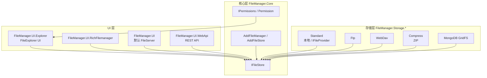
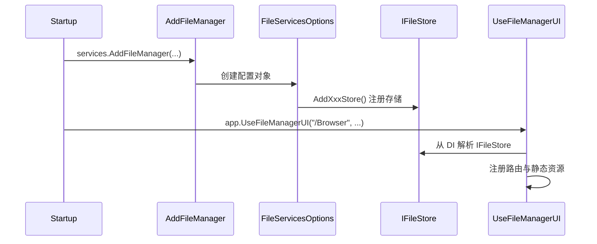

# 架构设计

## 设计原则

FileManager 采用**存储抽象 + UI 适配**的分层架构：

1. **核心层**（`FileManager.Core`）定义 `IFileStore` 接口与权限模型，不依赖具体存储或 UI。
2. **存储层**（`FileManager.Storage.*`）实现 `IFileStore`，对接不同文件源。
3. **UI 层**（`FileManager.UI.*`）将 HTTP 请求转换为 `IFileStore` 操作，并渲染前端界面。

各层通过 ASP.NET Core 依赖注入（`IServiceCollection`）组装。

## 架构图



## 核心接口

### IFileStore

虚拟文件存储的统一抽象，路径约定：

- 使用正斜杠 `/` 作为分隔符
- 路径相对于存储根目录，不支持绝对路径、`../` 父目录遍历
- 大小写敏感性由底层存储决定

主要方法：

| 方法 | 说明 |
|------|------|
| `GetFileInfoAsync` / `GetDirectoryInfoAsync` | 获取文件/目录元信息 |
| `GetDirectoryContentAsync` | 枚举目录内容 |
| `TryCreateDirectoryAsync` | 创建目录 |
| `TryDeleteFileAsync` / `TryDeleteDirectoryAsync` | 删除 |
| `MoveFileAsync` / `MoveDirectoryAsync` | 移动/重命名 |
| `CopyFileAsync` | 复制文件 |
| `GetFileStreamAsync` | 读取文件流 |
| `CreateFileFromStreamAsync` | 写入文件 |

定义位置：`Src/FileManager.Core/FileStore/IFileStore.cs`

### IFileStoreEntry

表示文件或目录的元数据：`Path`、`Name`、`DirectoryPath`、`Length`、`LastModifiedUtc`、`IsDirectory`。

### Permission

基于标志位的权限枚举，用于控制 UI 中的操作可见性：

| 权限 | 值 | 说明 |
|------|-----|------|
| ListSubFolders | 1 | 列出子文件夹 |
| ListFiles | 2 | 列出文件 |
| Create | 4 | 创建 |
| Delete | 8 | 删除 |
| Rename | 16 | 重命名 |
| Edit | 32 | 编辑 |
| Upload | 64 | 上传 |
| Download | 128 | 下载 |
| Compress | 256 | 压缩 |
| Extract | 512 | 解压 |
| Cut | 1024 | 剪切 |
| Copy | 2048 | 复制 |
| Paste | 4096 | 粘贴 |
| Preview | 8192 | 预览 |
| Print | 16384 | 打印 |
| CreatePublicLink | 1073741824 | 创建公共链接 |

通过 `AddPermissionHandle` 注册自定义权限逻辑；未注册时默认授予全部权限。

## 依赖注入流程



### 服务注册（ConfigureServices）

```csharp
services.AddFileManager(f => f
    .AddContentRootFileProviderReadOnly()   // 选择存储后端
    .AddPermissionHandle(entry => ...)      // 可选：权限控制
);
```

### 中间件注册（Configure）

```csharp
app.UseFileManagerUI("/Browser", f => f
    .UseFileExplorerUI()   // 选择 UI 类型
);
```

## UI 路由机制

`FileManager.UI.Explorer` 与 `FileManager.UI.RichFilemanager` 均基于 **AspNetCoreDashboard** 的路由分发：

- 前端 HTML/JS/CSS 作为**嵌入式资源**（EmbeddedResource）打包进程序集
- 通过 `RouteCollection` 注册 API 端点（如 `/Filemanager/ListFolder`）
- API 处理器从 DI 容器获取 `IFileStore` 执行业务逻辑

FileExplorer UI 的主要 API 端点：

| 端点 | 功能 |
|------|------|
| `/Filemanager/ListFolder` | 列出目录内容 |
| `/Filemanager/ExpandFolder` | 展开子目录树 |
| `/Filemanager/Create` | 创建文件夹 |
| `/Filemanager/Delete` | 删除文件/文件夹 |
| `/Filemanager/Rename` | 重命名 |
| `/Filemanager/Copy` / `/Move` | 复制/移动 |
| `/Filemanager/Download` | 下载文件 |
| `/Filemanager/GetThumbnail` | 图片缩略图 |
| `/Filemanager/Preview` | 文件预览 |
| `/Fileuploader/Begin` / `SendStream` / `End` | 分块上传 |

## 模块依赖关系

```
FileManager.Core
    ↑
    ├── FileManager.Storage.Standard
    ├── FileManager.Storage.Ftp
    ├── FileManager.Storage.WebDav
    ├── FileManager.Storage.Compress
    ├── FileManager.Storage.MongoDB
    ├── FileManager.UI (+ Storage.Standard)
    ├── FileManager.UI.Explorer (+ Core)
    ├── FileManager.UI.RichFilemanager (+ Core)
    ├── FileManager.UI.WebApi (+ Core)
    └── FileManager.UI.WebApi.Sdk
```

应用项目通常引用 `FileManager.UI.Explorer`（或 `FileManager.UI`）以及所需的 `FileManager.Storage.*` 包。
